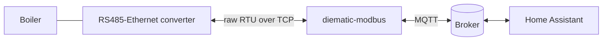

# diematic-modbus

Modbus RTU client for De Dietrich boilers with the **Diematic iSystem** regulator. It reads
every register of the boiler through an RS485-to-Ethernet converter, accepts changes, and hands
the values to pluggable brokers. The first plugin is MQTT with full **Home Assistant discovery**.

- Register maps are YAML files, not code: the iSystem map and a legacy Diematic 3 map ship with
  the project, and another system is one more file ([register maps](docs/register-maps.md)).
- Handles the Diematic bus rhythm: the boiler is master for about 5 s and only then listens, so
  requests are sent inside that window ([protocol](docs/protocol.md)).
- Every change is validated against the map, written, and confirmed by reading it back.
- Faults in the converter, the boiler or the broker never stop the service: it reconnects with
  backoff and reports availability.
- Runs as a container, as a Home Assistant app, or directly with Python 3.12.



## Quick start with Docker

```bash
cp .env.example .env        # set DIEMATIC_HOST / DIEMATIC_PORT and the MQTT_* values
docker compose up -d
```

Add `--profile broker` for a local Mosquitto, or `--profile sim` for a simulated boiler to try
things out without hardware ([development](docs/development.md)). Entities appear in Home
Assistant through MQTT discovery as soon as the first values have been read.

For Home Assistant OS use the app: [docs/haos-app.md](docs/haos-app.md).

## Without Docker

```bash
pip install .
export DIEMATIC_HOST=192.168.1.50 DIEMATIC_PORT=20108 MQTT_HOST=localhost
diematic run
```

| Command | Purpose |
|---|---|
| `diematic run [--config FILE]` | Run the service. |
| `diematic probe --from N --to M` | Dump a register range from the real boiler next to the map's names and decoded values, to check a map on your bus. |
| `diematic validate-map NAME_OR_FILE` | Check a register map and show its read plan. |
| `diematic simulate` | Serve a simulated boiler for development. |
| `diematic healthcheck` | Exit 0 if the heartbeat file is fresh (used by the container health check). |

## Documentation

| | |
|---|---|
| [Architecture](docs/architecture.md) | Components, data flow, resilience, extension points |
| [Protocol](docs/protocol.md) | Bus rhythm, framing, writes, encodings |
| [Configuration](docs/configuration.md) | Every setting, environment variables and YAML |
| [Register maps](docs/register-maps.md) | Map format, shipped maps, adding a system |
| [MQTT and Home Assistant](docs/mqtt-home-assistant.md) | Topics, entities, commands |
| [Home Assistant app](docs/haos-app.md) | Installing and publishing the HAOS app |
| [Development](docs/development.md) | Tests, simulator, project layout |

## Status and limits

- The iSystem map follows the manufacturer's parameter list for the GTW-26 gateway. Whether
  those addresses answer identically when the converter sits directly on the regulator's bus is
  not verified here; use `diematic probe` first and compare ([register maps](docs/register-maps.md#verifying-a-map-on-your-boiler)).
- The solar registers are exposed raw: the manual gives no units for them.
- A domestic hot water `water_heater` entity is not provided yet; the DHW setpoints are
  available as number entities.
- Only the MQTT plugin exists. The plugin interface is small ([architecture](docs/architecture.md#writing-a-plugin)).

You use this against your own heating system at your own risk: the project can change boiler
settings.
