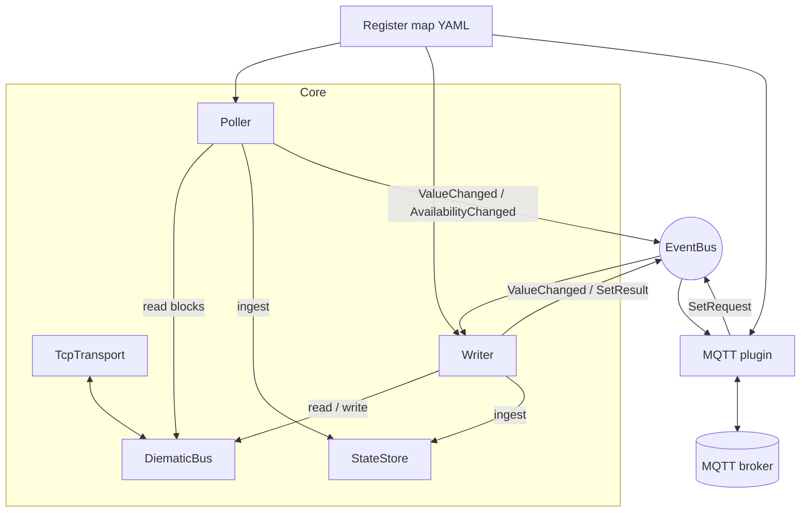
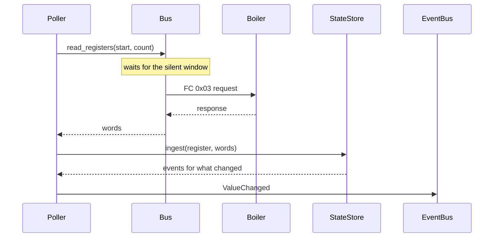
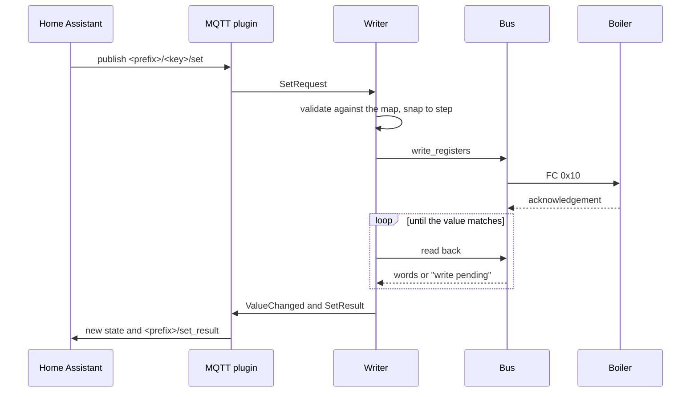

# Architecture

## Components



| Module | Responsibility |
|---|---|
| `transport/` | Byte pipe to the converter (`TcpTransport`) and reconnect `Backoff`. |
| `modbus/rtu.py` | Pure framing: CRC, request builders, a stream splitter that resyncs on garbage. |
| `modbus/bus.py` | Watches the line, finds the boiler's silent window, runs queued requests in it. |
| `registers/` | Map schema, loader, value codecs, read-block planner. |
| `core/poller.py` | Periodic reads per poll group, adaptive block sizing, availability. |
| `core/writer.py` | Validate, encode, write, confirm. |
| `core/state.py` | Last known values, change detection, derived sensors. |
| `core/events.py` | Bounded fan-out between the core and plugins. |
| `core/supervisor.py` | Restarts failing tasks with backoff. |
| `plugins/` | Plugin contract, entry-point loader, the MQTT plugin. |
| `sim/` | Simulated boiler used by the tests and `diematic simulate`. |

Plugins only exchange events with the core; they never touch the bus, so a misbehaving plugin
cannot disturb the Modbus traffic.

## Reading a value



## Changing a value



## Resilience

| Failure | Behaviour |
|---|---|
| Converter unreachable or link drops | `DiematicBus.run` reconnects with exponential backoff. Requests fail fast with `BusUnavailable`. The boiler is reported offline once no valid answer has arrived for `offline_after` seconds (120 by default), and polling retries every 10 s meanwhile. |
| Boiler lost behind a working converter | The gateway answers exceptions 0x0A/0x0B; counted as missing answers like timeouts. |
| A register the boiler never answers | Other reads still succeed, so the boiler stays online. After two missed cycles the register alone is skipped for an hour and then tried again; nothing is skipped while the whole link is down. |
| Gateway rejects a read | Blocks are split, gap bridging is switched off, unsupported registers are skipped and re-probed hourly. |
| Boiler talks while we wait for an answer | The request is requeued for the next window. |
| Write not applied or acknowledgement lost | Retried, then confirmed by read-back; the outcome is published as a `SetResult`. |
| Broker unreachable | The MQTT plugin crashes, the supervisor restarts it with backoff, and it re-announces everything on reconnect. The core keeps polling. |
| Plugin bug | Contained by the supervisor; other plugins and the core are unaffected. |
| Slow plugin | Its event queue is bounded and drops the oldest events; nothing blocks the poller. |
| Bad command payload | Dropped with a warning (size, encoding, number and flag checks). |

## Security

- Secrets (`MQTT_PASSWORD`) are `SecretStr`: never in `repr`, dumps or logs. Validation errors
  list field names only, never the offending input.
- Logs carry metadata (addresses, register keys, error text). Raw frames are logged only at
  `DEBUG`.
- Writes are limited to registers the map marks writable, within their limits; `read_only`
  refuses everything.
- The container runs as an unprivileged user, read-only, without capabilities.
- Use MQTT authentication and TLS (`MQTT_TLS`, `MQTT_TLS_CA`) on anything beyond a trusted
  network: anyone who can publish to `<prefix>/+/set` can change boiler settings.

## Extension points

### Another heating system

Add a register map (`maps/…yaml` in the package or any file) and set `DIEMATIC_MAP`; see
[register maps](register-maps.md). A new data type needs a codec in `registers/codecs.py`.

### Writing a plugin

Subclass `diematic.plugins.base.Plugin`, validate your configuration in `__init__` (raise
`PluginError`), and implement `run()` to serve until cancelled. Subscribe to
`context.events` for `ValueChanged`, `AvailabilityChanged` and `SetResult`; publish
`SetRequest` to change a register. Read `context.state.snapshot()` when you connect to catch up.
Register the class under the `diematic.plugins` entry-point group in `pyproject.toml`:

```toml
[project.entry-points."diematic.plugins"]
myplugin = "my_package.plugin:MyPlugin"
```

Enable it with `DIEMATIC_ENABLED_PLUGINS=myplugin` or a `plugins.myplugin` section in the YAML
file. Raise from `run()` when the connection is lost; the supervisor retries.
