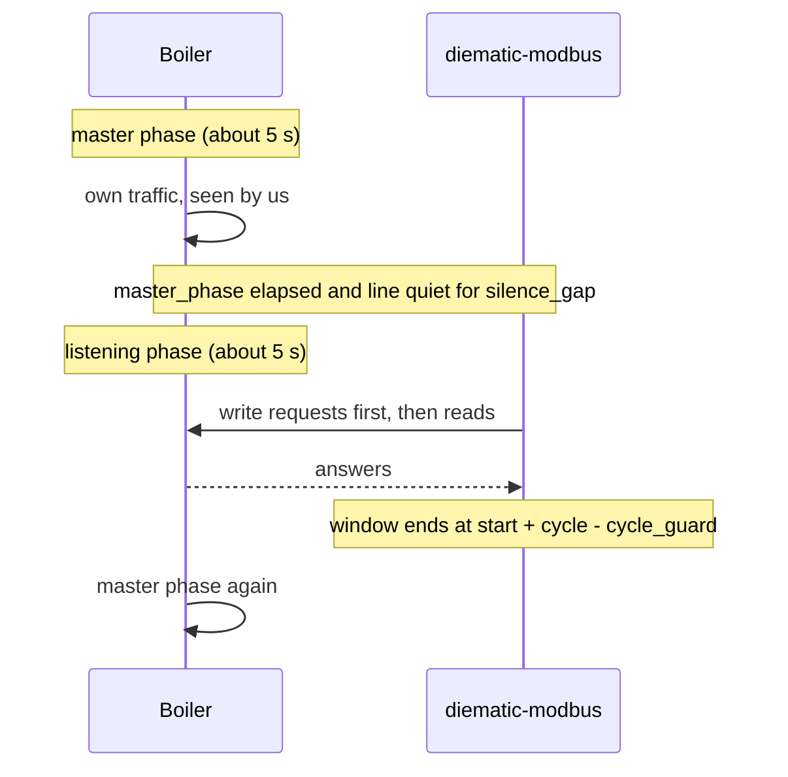

# Protocol

## Physical setup

An RS485-to-Ethernet converter sits on the boiler's Modbus port and exposes the serial line as a
TCP server. The project connects to it and exchanges **raw RTU frames** over the socket: no
Modbus TCP (MBAP) header. Configure the converter for the serial parameters of your bus
(typically 9600 baud, 8 data bits, no parity, 1 stop bit; check the setting of your gateway).

## The bus rhythm

The Diematic regulator is a master on its own bus for about five seconds and then listens for
about five seconds as a slave. A request sent while the boiler is talking collides with its
traffic and is lost, so the bus layer only transmits in the listening phase.

How a window is found (`modbus/bus.py`):

1. Every byte on the line is fed to a frame splitter; the arrival of traffic after a quiet
   period starts a *burst*.
2. A window opens when at least one request is queued, the burst is at least `master_phase`
   old, and the line has been quiet for `silence_gap`.
3. The window closes at `burst start + cycle - cycle_guard`, or after `window` seconds if that
   is sooner. Requests are served writes first, then reads, and a request is only sent if at
   least `min_request_time` is left.
4. If the boiler talks while we wait for an answer, the request goes back to the queue and
   waits for the next window.
5. If the line carries no boiler traffic at all for `idle_open_after`, a window opens anyway
   (a converter that does not forward the boiler's traffic, a simulator, a quiet bus).
6. After a request completes the window lingers briefly for the caller's next request, so a
   sequential poll cycle fits in one window.

| Setting (`gateway.bus.*`) | Default | Meaning |
|---|---|---|
| `master_phase` | 5.0 s | How long the boiler's talking phase lasts. **Must match the boiler**: a smaller value opens windows while the boiler is still talking. |
| `silence_gap` | 0.5 s | Quiet time that marks the start of the listening phase. |
| `cycle` | 10.0 s | Length of the full talk/listen cycle. |
| `cycle_guard` | 0.5 s | Safety margin before the boiler resumes. |
| `window` | 4.0 s | Longest window. |
| `idle_open_after` | 6.0 s | Quiet time after which a window opens without boiler traffic. |
| `response_timeout` | 2.5 s | How long to wait for one answer. |

A consequence of the rhythm: a command takes between about one and ten seconds to take effect.

## Frames

Function codes used: `0x03` read holding registers and `0x10` write multiple registers (writes
always use `0x10`, even for one register). The regulator's address defaults to 10 (`0x0A`).

Two quirks of the Diematic bus matter:

- **Padding byte.** Every frame we send is followed by one extra `0x00` byte, which the bus
  expects (`trailing_zero`, on by default). Frames from the boiler may carry it too, and the
  splitter ignores leading zeros because address 0 is never used.
- **CRC ambiguity.** For any valid frame, the CRC-16 of everything except its last byte equals
  that last byte. A 7-byte read response followed by the padding byte therefore also looks like
  a valid 8-byte read request. The splitter prefers the shortest CRC-valid reading.

A write is acknowledged by an echo of the first six bytes plus CRC. The gateway documents the
exceptions below.

| Code | Meaning | Handled as |
|---|---|---|
| 0x01 | Function not allowed | Refused |
| 0x02 | Address out of range | Poller narrows the read; a single unsupported register is skipped |
| 0x03 | Value out of range | Refused |
| 0x04 | Slave failure, write still in progress | Retry |
| 0x06 | Write pending on this register | Retry |
| 0x0A | Device not detected or lost by the gateway | Link failure |
| 0x0B | Gateway got no answer from the device yet | Link failure when polling; retry after a write |

## Writes

The gateway does not forward a write at once: it acknowledges, applies it later and answers
reads of that register with 0x06 and then 0x0B until the value is in place. The writer therefore
confirms every write by reading it back until the value matches, tolerating those answers
(`core/writer.py`). Flag registers are changed with read-modify-write so unrelated bits survive.

## Encodings

| Type | Encoding |
|---|---|
| `temp` | 16 bit, bit 15 is the sign, low 15 bits the magnitude in tenths; `0x8001` is -0.1; `0xFFFF` means unavailable. |
| `uint` | Unsigned 16 bit, optionally scaled. |
| `enum` | Unsigned 16 bit mapped to a label. |
| `bits` | Named flags in one register. |
| `time_program` | One weekday in three registers: one bit per half hour, most significant bit of the first register first, a set bit meaning the day (comfort) period. The manufacturer's example `0x0003 0xFFFF 0xFF00` is day from 07:00 to 20:00. Published as text such as `07:00-20:00,22:00-23:30`. |

Registers of larger counters are split (for example MWh / kWh / Wh); the map's `derived`
sensors add them up.
